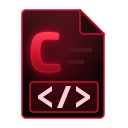

  

<h1 align="center">Crimson Code</h1>

A code editor for Linux with <a href="https://microsoft.github.io/language-server-protocol/">language servers</a>, a terminal and a task runner built in. 
Easy mode edits like <a href="https://code.visualstudio.com/">VS Code</a>, and one click switches to a <a href="https://www.vim.org/">Vim</a> inspired mode. 
Starts blazingly fast!

  
  
  

  <a href="https://github.com/Crimson-Org/crimson-code/releases/latest"><b>Download Here!</b></a>

## Why

Large editors are slow and crowded, and small ones lack language servers, a terminal and tasks.\
Crimson Code is fast and has all three.

## Features

### A project in a window

Open a folder to make it the project, and Ctrl+B shows its files in a sidebar.\
Files open in tabs, with a minimap instead of a scroll bar.\
Ctrl+Shift+R splits side by side and Ctrl+Shift+D stacks, and one file can show in several panes.\
F12 opens a terminal in the project folder.

### Plans and tagged comments

Ctrl+Shift+Y swaps the files for the plan, listing `TODO`, `*.todo` and `*.plan` files.\
A click checks a task, and each task's menu adds subtasks, archives it or deletes it.\
Comments tagged TODO, FIXME, BUG, HACK or XXX follow, under the file they sit in.\
Settings sets the file names, the tags and how each language starts a comment.

### Language servers

Servers such as [clangd](https://clangd.llvm.org/), [rust-analyzer](https://rust-analyzer.github.io/), [Pyright](https://microsoft.github.io/pyright/), [gopls](https://pkg.go.dev/golang.org/x/tools/gopls) and [TypeScript](https://github.com/typescript-language-server/typescript-language-server) start when a matching file opens.\
Settings lists the installed ones, and adding another needs only its command and file types.\
Errors and warnings show next to the line numbers, hovering shows the details and the server's documentation, and the status bar shows the message for the current line.

### Themes

Crimson Monokai, Crimson Monokai Light, Blitz, [Dracula](https://draculatheme.com/), [Nord](https://www.nordtheme.com/), [Gruvbox](https://github.com/morhetz/gruvbox), [Catppuccin](https://catppuccin.com/) and [Cupcake](https://github.com/rioam2/cupcake-ui) are built in.\
New Theme in Settings starts your own from a commented template.\
Colour codes such as #ff8800 get a small circle in their colour.

### Tasks

Tasks live in `.crimson-build/tasks.json`, and saving it writes a `.sh` and a `.cmd` script for each task.\
Steps can run commands, copy, move, remove, archive, download or upload files, or call another task.\
The scripts run without Crimson Code, for example `sh .crimson-build/build.sh`, and Ctrl+Shift+B runs a task in the terminal.\
`crimson-code --write-tasks PATH` writes the scripts without a window, where PATH is a project folder, its `.crimson-build` folder or its `tasks.json`.

### Commands and settings

Every action is a command with shortcuts and a Vim `:` name, and the menu and shortcut list are made from them.\
Vim inspired mode supports `:w`, `:q`, `:e file`, `:wq` and `:set`, such as `:set rnu`.\
Settings (Ctrl+,) holds every option.

## Building

You need a [C compiler](https://gcc.gnu.org/), [make](https://www.gnu.org/software/make/), [pkg-config](https://www.freedesktop.org/wiki/Software/pkg-config/) and the development files for [GTK4](https://gtk.org) 4.14, [libadwaita](https://gnome.pages.gitlab.gnome.org/libadwaita/) 1.6 and [GtkSourceView](https://gitlab.gnome.org/GNOME/gtksourceview) 5.16 or newer.\
On [openSUSE](https://www.opensuse.org/) these come from `sudo zypper install gcc make pkg-config gtk4-devel libadwaita-devel gtksourceview5-devel`.

Clone it with `git clone --recurse-submodules` so the shared Crimson Core code comes along.\
`sh .crimson-build/install.sh` installs it and `sh .crimson-build/uninstall.sh` removes it.\
`sh .crimson-build/run.sh` builds and starts it and `sh .crimson-build/archive.sh` writes a tar.gz to `dist/`.\
`sh .crimson-build/appimage.sh` writes an [AppImage](https://appimage.org/) to `dist/` on [Arch Linux](https://archlinux.org/).\
Those scripts are generated from the tasks in `.crimson-build/tasks.json` by [Crimson Build](https://github.com/Crimson-Org/crimson-build), so they work on any system with a shell.
