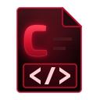
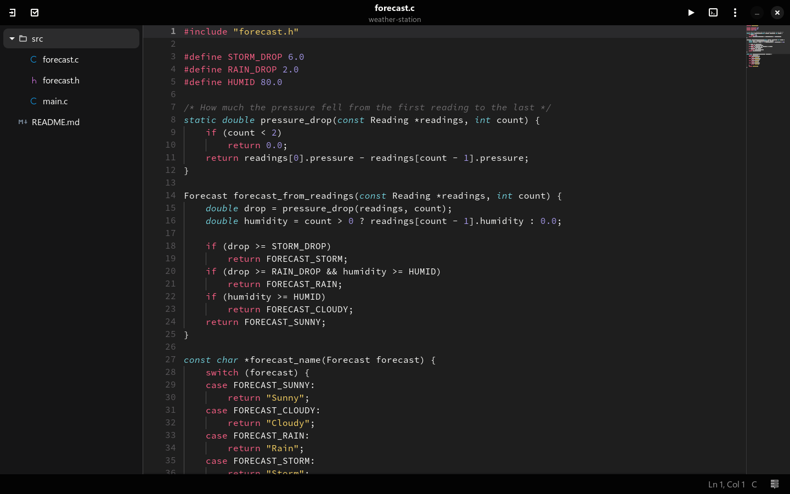

  

<h1 align="center">Crimson Code</h1>

A Linux code editor with <a href="https://microsoft.github.io/language-server-protocol/">language server</a> support, a terminal and a task runner. 
Easy editing like <a href="https://code.visualstudio.com/">VS Code</a>, with one click to switch to a <a href="https://www.vim.org/">Vim</a> inspired mode. 
Fast startup.

  
  
  

  <a href="https://github.com/Crimson-Org/crimson-code/releases/latest"><b>Download Here!</b></a>

  

## Why

Large editors are slow and crowded, and small ones lack language servers, a terminal and tasks.\
Crimson Code is fast and light, and includes all three.

## About

### Projects

Open a folder to see its files in a sidebar, with each file in a tab and a minimap beside it.\
Split the view to show files side by side, and open a terminal in the project folder.

### Language servers

Open a matching file to start its language server, such as [clangd](https://clangd.llvm.org/) for C or [Pyright](https://microsoft.github.io/pyright/) for Python.\
Errors and warnings appear beside the line numbers, and hovering shows the details.\
Add any other server's command in Settings.

### Plans

TODO and plan files show as tickable lists, next to the TODO and FIXME notes in your code.

### Tasks

Tasks build, run and test your project.\
Each task is also saved as a script, which runs without Crimson Code.

### Themes

Dark and light themes are included, and you can make your own from a template.

### Vim mode

One click switches to a Vim inspired mode, with commands like `:w`, `:q` and `:e`.

## Building

You need a [C compiler](https://gcc.gnu.org/), [make](https://www.gnu.org/software/make/), [pkg-config](https://www.freedesktop.org/wiki/Software/pkg-config/) and the development files for [GTK4](https://gtk.org), [libadwaita](https://gnome.pages.gitlab.gnome.org/libadwaita/) and [GtkSourceView](https://gitlab.gnome.org/GNOME/gtksourceview).\
On [openSUSE](https://www.opensuse.org/) these come from `sudo zypper install gcc make pkg-config gtk4-devel libadwaita-devel gtksourceview5-devel`.

Steps:
 1. Clone using `git clone --recurse-submodules https://github.com/Crimson-Org/crimson-code`
 2. Run `sh .crimson-build/install.sh`

`sh .crimson-build/uninstall.sh` removes it again.
